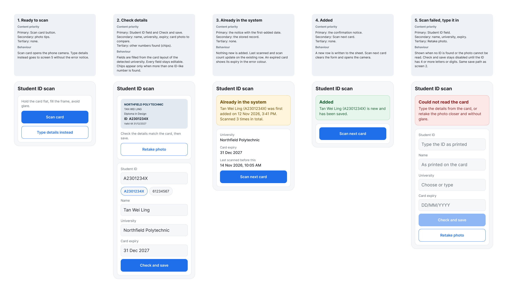

# Student ID scan

Phone web app. Take a photo of a student card, it reads the ID on the phone (Tesseract.js, nothing sent to an OCR service), then checks a Google Sheet. New IDs are added; known IDs show an "Already in the system" notice with the date first added and the scan count.

## Install (about 5 minutes)

1. Create a Google Sheet. Open **Extensions > Apps Script**.
2. In `Code.gs`, select everything (Cmd+A or Ctrl+A), delete it, then paste in `Code.gs`. Do not paste inside the starter `function myFunction() {}`, or the app fails with "Script function not found: doGet".
3. Next to **Files**, click **+ > HTML** and type `Index` only (capital I, no `.html`; the editor adds it). Paste in `Index.html`. A file named `index.html` or `Index.html.html` fails with "No HTML file named Index was found".
4. **Project Settings**: set the time zone (used for the "first added" date).
5. **Deploy > New deployment > Web app**.
   - Execute as: **Me**
   - Who has access: **Anyone within [your organisation]** if available, otherwise **Anyone with a Google account**. Avoid "Anyone": the register holds student IDs.
6. Authorise. The script asks for access to this spreadsheet only (`@OnlyCurrentDoc`). On the "Google hasn't verified this app" pop-up, click **Advanced > Go to (project name) (unsafe) > Allow**; the warning is expected for your own script. Copy the web app URL, open it on the phone, and add it to the home screen.

The sheet tab **Students** is created on first save: Student ID, Name, University, Card expiry, First scanned, Last scanned, Scan count. A sheet made by an earlier version gets the missing columns added in place on the next save. Card expiry is stored as printed; a renewed card replaces it on the next scan.

The offer shown after saving (`OFFER_NEW`, `OFFER_RETURNING`) and a preset list of universities (`UNIVERSITIES`) are set at the top of `Code.gs`. University names already in the sheet are offered as suggestions, and a known name printed on the card is filled in automatically.

## Screens

1. **Ready**: scan the card, or type the details in.
2. **Check details**: the photo beside the fields read from it. When several ID-like numbers are found, they show as chips to tap.
3. **Already in the system**: how many times the student has been scanned, the offer they are eligible for, their university, card expiry (in red once expired) and when they were last scanned. Nothing new is written.
4. **Added**: a new row is saved, with the offer for new students.
5. **Manual entry**: shown when the card cannot be read. Save stays disabled until an ID is entered.

The app reads the student ID from the photo. University is filled when a known university name is printed on the card; otherwise it is chosen or typed. Card expiry is filled from the latest date found on the card (DD/MM/YYYY, DD-MM-YY or MM/YYYY), since birth and issue dates are earlier. Name is typed. Reading the name, and dates printed in other formats, needs a card layout for each university (below).

## Card layouts for each university

Each university prints its card differently, so name, university and expiry are read from a layout per university. To add one, prepare a reference card:

1. Take a straight, glare-free photo of the card front (and back, if details are there). Use a sample card or blur the photo and face where possible.
2. In a design tool (Figma or similar), place the photo in a frame named after the university.
3. Draw a rectangle over each field and name it exactly `ID`, `Name`, `University` or `Expiry`. Cover the value only, not its printed label.
4. Note one or two words that only appear on that university's card (for example the university name as printed). These identify which layout to use.
5. Note the expiry format as printed (for example `31/12/2027` or `DEC 2027`).

Each layout becomes a set of field regions, measured as a share of the card's width and height, plus the identifying words. Keep card photos out of this repository.

## Changing the ID format

`Index.html` has `ID_PATTERN` near the top of the script. The default accepts up to two letters, 5 to 10 digits and an optional trailing letter (2301234, A0123456X). Tighten it to the real card format so phone numbers and dates are not picked up.

## Notes

- If the phone shows "Sorry, unable to open the file at present", the browser is signed into more than one Google account. Open the link in a private tab and sign in with the account that has access.
- After editing code, use **Deploy > Manage deployments > Edit > New version**, or the URL keeps serving the old code.
- The scanner always fills an editable field; the person scanning confirms before saving. When several numbers are found, they appear as chips to tap.
- IDs are stored upper case with spaces and symbols removed, as text, so leading zeros stay.
